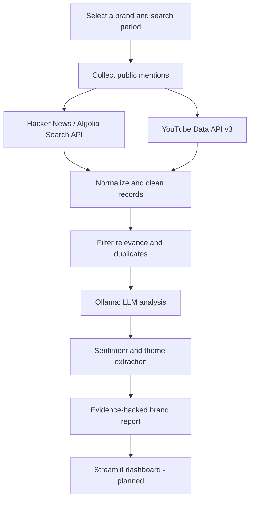

# BrandPulse AI

**AI-powered brand listening and sentiment intelligence from public online conversations.**

BrandPulse AI is a **personal, non-commercial learning project** that explores how locally hosted large language models can turn public discussions about a brand into structured insights. The initial data sources are **Hacker News** and **YouTube**, and the analysis engine uses **Ollama**.

> **Project status:** Planning / initial development. This README describes the intended MVP and proposed structure; the ingestion pipelines, AI analysis, and UI are not implemented yet.

## What problem does it solve?

People discuss brands in online communities, product-review videos, and comment sections. Reading those conversations manually is slow, and raw sentiment labels alone don't explain *why* people feel the way they do.

BrandPulse AI is designed to answer questions such as:

- What is the overall sentiment toward a selected brand?
- Which product issues or customer pain points appear repeatedly?
- What do people praise most?
- What are the most common complaints and requests?
- Which discussion themes are emerging over the selected time period?
- Which specific posts or comments support each finding?

The goal is **evidence-backed qualitative insight**, not to claim that online commenters represent every customer of a brand.

## Planned MVP features

- **Brand search:** Select a company or brand and search public discussions that mention it.
- **Multi-source collection:** Pull relevant Hacker News stories/comments and YouTube video comments.
- **Unified dataset:** Normalize records into a consistent schema across platforms.
- **Data preparation:** Clean text, de-duplicate content, and filter irrelevant or ambiguous mentions.
- **Local LLM analysis:** Use Ollama models to identify sentiment, praise, complaints, pain points, and themes.
- **Traceable findings:** Preserve source URLs and example comments alongside reported insights.
- **Results dashboard:** Explore sentiment breakdowns and summarized findings in a proposed Streamlit interface.

## How it will work



The application will use **existing LLMs for inference**. It is **not intended to train or fine-tune models on platform content**.

## Tech stack

| Component | Technology | Purpose |
| --- | --- | --- |
| Language | Python | Data collection, processing, and orchestration |
| Discussion source | Hacker News via Algolia Search API | Search public technology discussions and comments |
| Video-comment source | YouTube Data API v3 | Find relevant videos and retrieve public comments |
| AI engine | Ollama | Run LLMs locally for classification and summarization |
| Data processing | pandas | Prepare, merge, and analyze retrieved records |
| App interface *(planned)* | Streamlit | Brand selection and insight exploration |
| Configuration | `.env` variables | Keep credentials and runtime settings out of source code |

## Data collection strategy

### Hacker News

- Query the Algolia Hacker News Search API for brand and product-name mentions.
- Retrieve relevant stories and comments, including identifiers, text, timestamps, and source links.
- Focus initially on technology companies because the audience is tech-oriented.
- Public search endpoint: <https://hn.algolia.com/api>

### YouTube

- Use YouTube Data API v3 to find videos discussing the selected brand or its products.
- Retrieve available public comments from those videos; account for disabled comments, pagination, and quota limits.
- Keep the video and comment identifiers so findings can link back to their source.
- Note that searching for videos and reading their comments **does not capture every brand mention on YouTube**.
- API documentation: <https://developers.google.com/youtube/v3>

**Access requirement:** Hacker News Algolia searches are available without an API key. YouTube requires enabling YouTube Data API v3 in a Google Cloud project and configuring an API key for the relevant public-data requests.

## Proposed unified record schema

Each collected mention should map to a common record, for example:

| Field | Meaning |
| --- | --- |
| `brand` | Brand being analyzed |
| `source` | `hacker_news` or `youtube` |
| `source_id` | Source-specific story/comment identifier |
| `text` | Relevant post/comment text |
| `created_at` | Source publication timestamp |
| `source_url` | Link to the original content |
| `collected_at` | Time the app retrieved the record |
| `is_relevant` | Whether the mention really refers to the intended brand |

Store derived sentiment, themes, and analysis-model metadata separately from the raw source records so results can be audited and refreshed.

## Planned AI analysis outputs

For each relevant mention, the LLM can produce a structured result containing:

- **Relevance:** On-topic or off-topic, with a short reason.
- **Sentiment:** Positive, negative, neutral, or mixed, with an optional confidence indicator.
- **Themes:** Product quality, pricing, reliability, support, usability, performance, and any new discovered themes.
- **Customer signals:** Praises, pain points, feature requests, or recurring problems.
- **Evidence:** A source reference and an appropriately brief supporting excerpt.

At the brand level, these results can be aggregated into a summary of common positives, complaints, trends, and traceable examples. Model outputs should be validated as structured data rather than trusted unconditionally.

## Proposed repository structure

This is the **target layout**, not a claim that these files already exist:

```text
brandpulse-ai/
├── app.py                        # Streamlit app (planned)
├── requirements.txt              # Python dependencies
├── .env.example                  # Example configuration without secrets
├── .gitignore
├── README.md
├── src/
│   ├── ingestion/
│   │   ├── hacker_news.py        # Hacker News API adapter
│   │   └── youtube.py            # YouTube API adapter
│   ├── processing/
│   │   ├── normalize.py          # Unified records
│   │   ├── clean.py              # Cleaning and deduplication
│   │   └── relevance.py          # Brand relevance filter
│   ├── analysis/
│   │   ├── ollama_client.py      # Local LLM integration
│   │   ├── sentiment.py          # Mention-level analysis
│   │   └── insights.py           # Aggregate brand insights
│   └── reporting/
│       └── report.py             # Insight preparation
├── tests/
└── data/                         # Local working data; do not commit raw exports
```

## Environment and setup (once the MVP code is added)

**Prerequisites:** Python 3.11+, Ollama installed locally, and a YouTube Data API key.

1. Install [Ollama](https://ollama.com/download), then pull a compatible model, for example:

   ```bash
   ollama pull llama3.2
   ```

2. Create a Google Cloud project, enable [YouTube Data API v3](https://developers.google.com/youtube/v3/getting-started), and create an API key.

3. Once the project files have been implemented, create a virtual environment and install dependencies:

   ```bash
   python -m venv .venv
   # Activate .venv using your operating system's shell.
   pip install -r requirements.txt
   ```

4. Add your local configuration in `.env` (do not commit this file):

   ```dotenv
   YOUTUBE_API_KEY=your_google_cloud_api_key
   OLLAMA_BASE_URL=http://localhost:11434
   OLLAMA_MODEL=llama3.2
   ```

5. The planned dashboard launch command is:

   ```bash
   streamlit run app.py
   ```

   **Note:** The install and launch steps will only work after the corresponding application files have been added to the repository.

## Planned development roadmap

- [ ] Establish Python project structure and environment configuration.
- [ ] Implement Hacker News search and collection.
- [ ] Implement YouTube video discovery and comment collection.
- [ ] Normalize records, filter relevance, and remove duplicates.
- [ ] Implement Ollama structured sentiment and theme analysis.
- [ ] Aggregate mention-level output into evidence-backed brand findings.
- [ ] Build the initial Streamlit dashboard.
- [ ] Add tests, caching, pagination, error handling, and rate-limit awareness.
- [ ] Evaluate analysis quality using a small manually labeled sample.

## Responsible use and limitations

- **Non-commercial learning use:** The project is intended for education and experimentation. Non-commercial status does not override API terms.
- **Respect source policies:** Follow the applicable [YouTube API Services Terms](https://developers.google.com/youtube/terms/api-services-terms-of-service), relevant developer policies and derived-metrics requirements, and Hacker News/Algolia terms. Review storage, display, refresh, and deletion obligations before collecting data at scale.
- **Minimize personal data:** Only collect fields required for the analysis, avoid unnecessary user-profile details, and keep API keys private.
- **No unauthorized scraping:** Use documented interfaces and authorized access methods.
- **Sampling bias:** Hacker News skews toward technology discussions. YouTube comments represent viewers who choose to comment on videos selected by the search process.
- **LLM fallibility:** Sarcasm, jokes, ambiguity, brand-name collisions, and missing context can distort classifications. Check outputs against source content.
- **No population-level inference:** Sentiment percentages describe the retrieved sample, not all customers or the market as a whole.

## Useful references

- [Hacker News Algolia Search API](https://hn.algolia.com/api)
- [YouTube Data API v3](https://developers.google.com/youtube/v3)
- [Google Cloud Console](https://console.cloud.google.com/)
- [Ollama](https://ollama.com/)
- [Ollama API documentation](https://docs.ollama.com/api)
- [Streamlit documentation](https://docs.streamlit.io/)


**BrandPulse AI** — Learn to build brand intelligence with public conversations and local LLMs.
